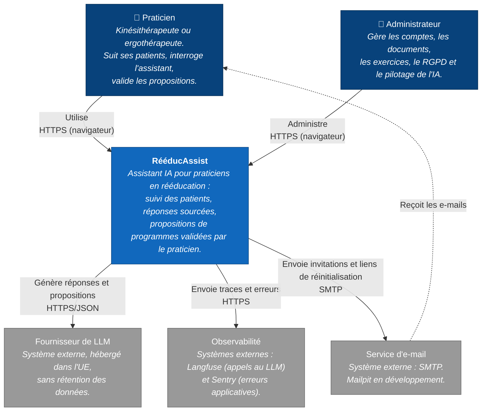
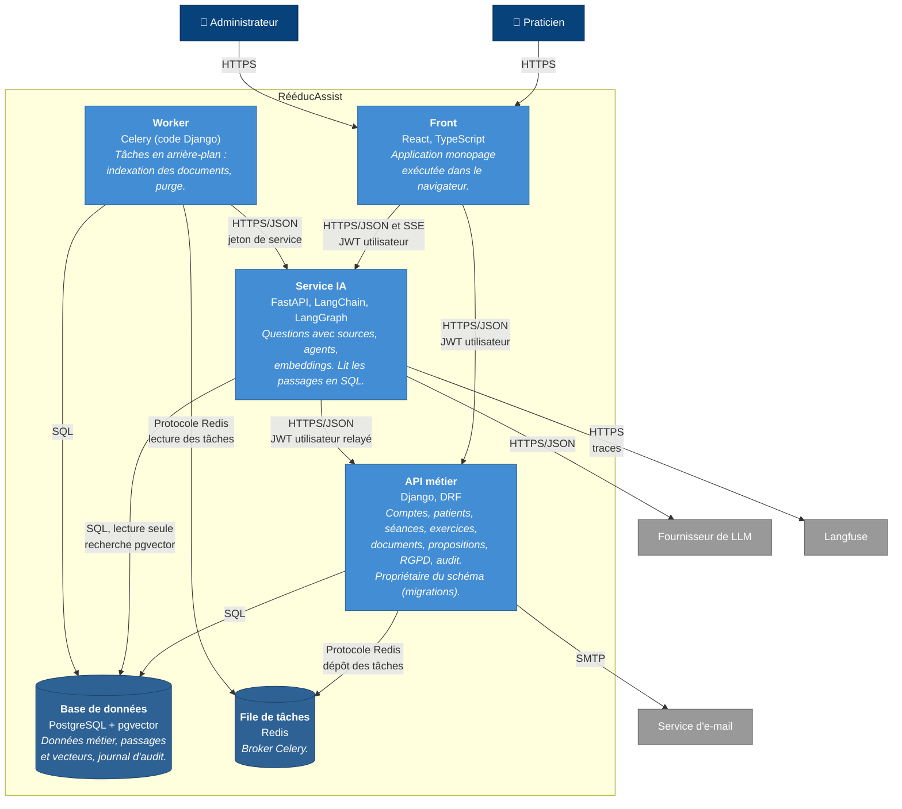

# Architecture : diagrammes C4, niveaux 1 et 2

- **Ticket** : RA-011
- **Sources** : `docs/01-cadrage.md`, tickets du board RééducAssist (RA-028, RA-041, RA-043, RA-071, RA-072, RA-081, RA-083, RA-090, RA-115).
- **Statut** : à valider. La répartition des responsabilités entre Django et le service IA sera justifiée dans l'ADR-010 (RA-013).

Le modèle C4 décrit une architecture par zooms successifs. Le niveau 1 montre le système comme une seule boîte, avec ceux qui l'utilisent et les systèmes externes dont il dépend. Le niveau 2 ouvre la boîte et montre les conteneurs, c'est-à-dire les éléments qui s'exécutent séparément, et la façon dont ils communiquent.

## Niveau 1 : contexte

## Niveau 2 : conteneurs

Les quatre conteneurs applicatifs (front, Django, service IA, worker) envoient aussi leurs erreurs à Sentry en HTTPS (RA-028). Ces flèches sont omises pour garder le schéma lisible.

## Flux du niveau 2

| De | Vers | Protocole | Pour quoi faire | Ticket |
|---|---|---|---|---|
| Praticien, administrateur | Front | HTTPS | Utiliser l'application dans le navigateur | RA-110 |
| Front | API Django | HTTPS/JSON, JWT utilisateur | Toutes les opérations métier | RA-042, RA-050 |
| Front | Service IA | HTTPS/JSON et SSE, JWT utilisateur | Poser une question, suivre la réponse mot à mot, demander une proposition | RA-043, RA-081, RA-115 |
| Service IA | API Django | HTTPS/JSON, JWT de l'utilisateur relayé | Lire le contexte patient pseudonymisé (l'isolation s'applique), enregistrer une proposition | RA-082, RA-083 |
| Service IA | PostgreSQL | SQL, lecture seule | Rechercher les passages les plus proches de la question (pgvector) | RA-081 |
| API Django | PostgreSQL | SQL | Lire et écrire les données, avec la Row-Level Security | RA-044, RA-050 |
| API Django | Redis | Protocole Redis | Déposer une tâche (indexation d'un document importé) | RA-071 |
| Worker | Redis | Protocole Redis | Récupérer les tâches à exécuter | RA-071 |
| Worker | PostgreSQL | SQL | Écrire les passages et leurs vecteurs, purger les données à échéance | RA-072, RA-102 |
| Worker | Service IA | HTTPS/JSON, jeton de service | Calculer les vecteurs des passages (`/internal/embeddings`) | RA-043, RA-072 |
| Service IA | Fournisseur de LLM | HTTPS/JSON | Générer une réponse, une proposition, un compte rendu | RA-081, RA-083, RA-086 |
| Service IA | Langfuse | HTTPS | Tracer chaque appel au LLM (coût, latence, version du prompt) | RA-090, RA-094 |
| API Django | Service d'e-mail | SMTP | Envoyer les invitations et les liens de réinitialisation | RA-041, RA-046 |

## Choix retenus

- **Accès aux données en deux voies, comme le prévoient les tickets.** Le service IA lit directement en SQL les passages et leurs vecteurs pour la recherche pgvector (RA-081) : c'est la requête la plus fréquente, et elle ne porte sur aucune donnée patient. En revanche, il passe par l'API Django pour tout ce qui touche aux patients : le contexte patient (RA-082) et l'enregistrement des propositions (RA-083). Les droits et la Row-Level Security sur les données patients restent ainsi appliqués par Django. À justifier dans l'ADR-010 (RA-013).
- **Le service IA relaie le JWT de l'utilisateur** quand il appelle Django : Django applique alors les droits du praticien connecté, comme si la requête venait du front. Le service IA ne voit jamais l'identité du patient (ENF-RGPD-3).
- **Django reste propriétaire du schéma** : les tables, y compris celle des passages, sont créées par ses migrations. Le service IA s'y connecte en lecture seule ; le compte PostgreSQL qu'il utilise et ses droits exacts sont à préciser dans l'ADR-010.
- **Le worker exécute du code Django** : il accède à la base comme l'API, et n'appelle le service IA que pour calculer les vecteurs.
- **Le front appelle directement le service IA** pour les questions, afin de diffuser la réponse en streaming (SSE) sans passer par Django.
